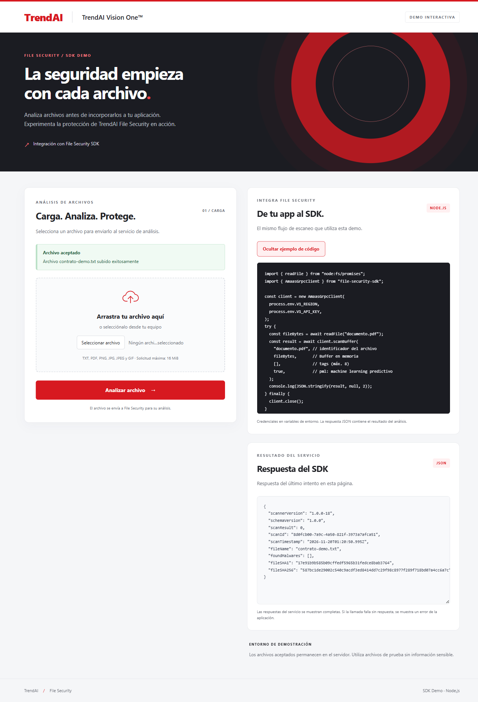

# File Security SDK demo (Node.js)

Web demo of the TrendAI Vision One **File Security SDK for Node.js** (`file-security-sdk`). A user uploads a file in the browser, the app scans it **in memory** with `AmaasGrpcClient.scanBuffer` (predictive machine learning enabled) and only stores it if it is clean.

Node.js/Express port of [XeniaP/V1_FS_DemoApp_py](https://github.com/XeniaP/V1_FS_DemoApp_py) (Flask), with the same UI, flow and logs.

> The web UI and messages are in **Spanish**, like the original demo.



## Requirements

- Node.js **>= 22.23.4** (required by `file-security-sdk` 1.4.8). Tested with Node 24.
- A Vision One API key whose role only has **File Security > Run file scan via SDK** (least privilege), and your tenant region (e.g. `us-east-1`).
- Outbound access to the regional File Security service (gRPC over TLS, port 443).

## Configuration

Create `.env` (already in `.gitignore` and `.dockerignore`). **Do not quote the values**: `docker run --env-file` keeps quotes as part of the value (`'us-east-1'` → `Invalid region`).

```bash
V1_API_KEY=<API_KEY>
V1_REGION=us-east-1
UPLOAD_FOLDER=uploads
PORT=8080
```

## Run

```bash
npm ci
npm start          # node --env-file-if-exists=.env app.js
# or
bash run.sh        # loads .env, checks variables and Node version, npm ci, starts
npm test           # node:test, does not call the service
```

Open http://localhost:8080. Health checks: `curl localhost:8080/health` and `/ready`.

Container (runs as UID 1001 / GID 0, OpenShift-friendly):

```bash
docker build -t fs-demoapp-node .
docker run --rm --env-file .env -p 8080:8080 fs-demoapp-node
```

Test with a clean file and with EICAR (generated in memory, never written to disk):

```bash
curl -F file=@docs/contrato-demo.txt http://localhost:8080/
node examples/eicar.js | curl -F "file=@-;filename=eicar.txt" http://localhost:8080/
```

Minimal CLI example without the web app:

```bash
node --env-file=.env examples/escanear.js <file>
node --env-file=.env examples/escanear.js --eicar
```

## How it works

| Piece | File |
|---|---|
| Upload, validation (TXT/PDF/PNG/JPG/JPEG/GIF, 16 MiB), safe file name, atomic save of accepted files | `app.js` |
| SDK call (`scanBuffer(fileName, buffer, [], true)`), clean/malicious decision, error mapping, JSON logs | `scan.js` |
| HTML page (all dynamic text escaped) | `views.js`, `public/` |

The file is kept in memory (`multer.memoryStorage()`) and is written to `UPLOAD_FOLDER` only when the scan is clean. A response counts as clean only if `scanResult` is 0 and there are no malware findings, errors or unknown data.

### Python → Node.js equivalents

| Python (Flask) | Node.js (Express) |
|---|---|
| `visionone-filesecurity==1.5.1` (`amaas.grpc`) | `file-security-sdk@1.4.8` (`AmaasGrpcClient`) |
| `init_by_region(region, api_key)` | `new AmaasGrpcClient(region, apiKey)` |
| `scan_buffer(handle, bytes_buffer, uid, pml=True)` | `client.scanBuffer(fileName, buffer, [], true)` |
| `quit(handle)` | `client.close()` |
| `AMaasErrorCode` (codes) | `error.message` text (the Node SDK does not expose the gRPC code) |
| `request.files` + `MAX_CONTENT_LENGTH` 16 MiB | `multer.memoryStorage()` + `limits.fileSize` 16 MiB |
| `secure_filename` | `secureFilename()` in `app.js` |
| `FLASK_SECRET_KEY` (flash messages in a cookie) | Not needed: messages are rendered in the same response |

## Logs

One JSON line per event on stdout/stderr:

- `filesecurity.scan.response`: full SDK response, SDK version, file name, `elapsed_ms`, `correlation_id`.
- `filesecurity.scan.decision`: `accepted` true/false.
- `filesecurity.api_key.alert`: safe message, without the key or the raw service error.

## Findings

- With an invalid key, SDK 1.4.8 sometimes returns `You are not authenticated…` and sometimes `Service is not reachable. Name resolution failed for target dns:antimalware.us-1.cloudone.trendmicro.com:443` (a key that is not a Vision One key makes the SDK try another host). The app shows a specific message for each case.
- `npm ci` warns that the `protobufjs` `postinstall` script was not run (npm install-scripts policy). The app works anyway.

## Tested

- File Security SDK 1.4.8, Node 24, `us-east-1`: clean file → accepted and stored (~1.5 s); EICAR → `scanResult 1`, `Eicar_test_file`, not stored (~0.8 s); invalid key → controlled alert.
- Docker image (`node:24.11.1-slim`): same results.
- `npm test`: 6/6. `npm audit`: 0 vulnerabilities.

## Credits and license

UI (`public/app.css`, `public/app.js` and the HTML in `views.js`) comes from [V1_FS_DemoApp_py](https://github.com/XeniaP/V1_FS_DemoApp_py), © 2024 Yessenia Becerra. MIT license, see [`LICENSE`](LICENSE).
